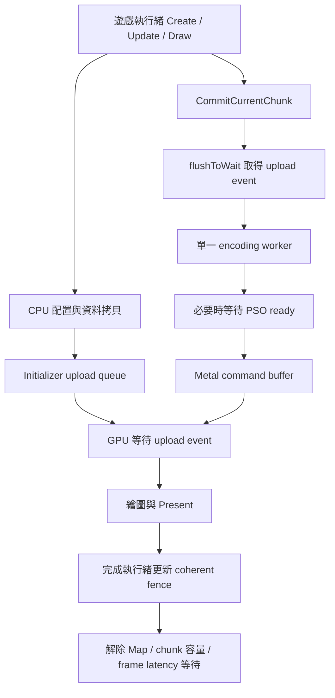

# 新楓之谷：DXMT buffer／紋理、CPU 與提交同步研究

日期：2026-09-21。狀態：**完成程式檢查、GPU 重現與 allocator 控制實驗；候選優化尚未部署。**

## 結論與證據範圍

現有 DXMT 有可優化處，最有依據的是 **pitch 不相等時逐列上傳的跨界成本**、**已完成 block 的回收邊界**，以及 **初始化 flush 與全佇列等待放大的延遲**。另外找到一個可用真實 GPU 穩定重現的資料正確性缺陷：初始化 CPU 命令區耗盡後，當次操作沒有重試，造成初始紋理資料遺失。

這些發現不能直接宣告修好新楓之谷首次命中約 655–749 ms 的停顿。本機目前沒有可執行的遊戲本體，這輪沒有新的遊戲 trace；舊資料只能確認首次命中的出幀停滯。名為 `-[AGXBuffer initImplWithHeap:…]` 的執行緒並不等於其每筆樣本都在 buffer allocator 裡執行，不能用執行緒名稱推定根因。

本輪對照：

- 本機 DXMT v0.80 + 前輪獨立 PSO archive overlay，標籤 `v0.80-cyder-pso-lab-cb6fa6f818d66dad`。
- DLL SHA-256：`be4913fea6371c526bb62870d8d106e1a1bb4ae20017c2f70af452e068ec70b3`。
- Wine `install/wine-cx26-x86_64`；測試在新的 `/private/tmp/dxmt-resource-study-20260921/prefix`，未啟動遊戲。
- GameToMac 0.1.19 build57 的 Overwatch DXMT：`resource_initializer.cpp`、`ring_bump_allocator.hpp`、`dynamic.cpp` 與官方 v0.80／本機 lab **逐位元相同**。其 `command_queue.cpp/.hpp` 差異是增加 trace scope，沒有改變等待的實質邏輯。
- 以下 source 路徑以 `build/dxmt-pipeline-lab/source/` 為根目錄；這是明確版本檢查，不是宣稱最新版上游狀態。

## 1. 紋理初次建立與更新：合併逐列跨界上傳

位置：`src/dxmt/dxmt_resource_initializer.cpp:254`、`src/d3d11/d3d11_context_impl.cpp:4149`、`src/winemetal/unix/winemetal_unix.c:2510`。

現有 `CreateTexture*` 初始化與 `UpdateSubresource` 都先取得 staging buffer。來源 row pitch 不等於有效列寬時，每列呼叫一次 `WMT::Buffer::updateContents`；原生端每次都取 `[buffer contents]`、`memcpy`，若實際 storage mode 為 managed，再呼叫一次 `didModifyRange`。Initializer 全程持有自身 mutex；UpdateTexture 則在 context mutex 內做這些操作。

例如未壓縮 257×512 RGBA8 圖，有效 row size 為 1028 bytes，來源 pitch 為 1280：一次上傳變成 **512 次 bridge call**；緊密排列則是 **1 次**。BC 格式按 block row 計算，不能直接套像素高度。

建議實作：新增可處理 row/depth stride 的批次上傳介面，在原生端一次完成列拷貝，最後針對實際寫入範圍通知一次；或讓 x64 staging allocation 暴露可存取的映射位址，在 PE 端拷貝後統一通知。後者需區分 `mapped_address` 的所有權與原生 buffer contents，不能把借用位址交給現有 destructor `free()`。i386 指標可達性需保留安全回退。

保留來源生命期契約：CreateTexture／UpdateSubresource 返回前必須已取走來源資料，不能把遊戲的原始指標丟給背景執行緒晚點讀。保留壓縮格式、mip、array、3D slice pitch、部分 box 的精確範圍。這是在減少呼叫與通知次數，不是省略必要資料或同步。managed buffer 的 CPU 寫入仍需通知 GPU，見 [Apple didModifyRange](https://developer.apple.com/documentation/metal/mtlbuffer/1516121-didmodifyrange)。

**實測**：同一程序 10 次交錯 tight/padded，每次 64 張 257×512 RGBA8，全部逐列 GPU readback 正確。暖機後 trial 4–9：

| 輸入 layout | 64 張 CreateTexture2D 時間 | 中位數 |
|---|---:|---:|
| tight，pitch 1028 | 1.308 / 1.605 / 1.395 ms | 1.395 ms |
| padded，pitch 1280 | 2.532 / 2.819 / 2.561 ms | 2.561 ms |

這是 **同版 DLL 的輸入 layout 比較，不是優化前後比較**。差值包含 repack 與 bridge 等成本，不能全歸因單一函式；首輪 cold tight 11.082 ms、後續 padded 8.223 ms 也不能公平互比。後面的 copy／Map／讀回驗證計時獨立，未混入 Create 時間。每種暖機樣本只有 3 次，不能作為遊戲效能承諾。

對新楓之谷：若命中特效／傷害字首次出現會大量建立或更新帶 padding 的紋理，這項有機會降低 CPU burst；若來源全部 tight，收益很有限。單看目前微測試的毫秒量級，尚不能解釋約 0.7 秒卡頓。

## 2. 初始化命令區耗盡：真實 GPU 已重現的正確性缺陷

位置：`src/dxmt/dxmt_resource_initializer.cpp:10` 及五個 `do { … } while (0)` 呼叫點；`src/dxmt/dxmt_resource_initializer.hpp:11` 的 CPU heap 上限為 1 MiB。

配置 macro 失敗會 `flushInternal(); continue;`，但包住它的是 `do … while (0)`。C++ 的 `continue` 會跳到條件 `0`，因此離開迴圈，**沒有重新配置並完成當次初始化**。RETAIN 所需儲存空間或 blit command 空間耗盡都能進入此路徑。

GPU 重現流程：先建立帶明確 initial data 的 1×1 RGBA8 texture arrays，每 array 2048 個 slice，完全建好後再複製到 atlas，讀回逐像素比對。

| 案例 | GPU 結果 |
|---|---|
| 4 arrays，8192 subresources | 8192/8192 正確 |
| 8 arrays，16384 subresources | slice **9294**（零起算）遺失；expected `ff00244f`，actual `00000000` |
| 重新啟動 probe 重跑 16384 | 同一個 slice 9294 再次失敗 |

所有資源都有明確 initial data，因此這不是讀取「未指定初始資料」的 undefined contents。failure process 的 exit code 是 1，保留為缺陷證據，未算成 graphics pass。

修正方向：把一次初始化改成能確實重試的操作；先完成 heap 空間與資源保留的預留，再串入完整 command，容量不足 flush 後重建當次操作。**不能只把 while(0) 無條件改成 while(true)**：要有成功離開與永久配置失敗處理；且目前 initWithData 是先串入 blit command、後取 GPU buffer，失敗時不能 flush 尚未填好內容的 command。實作時需涵蓋每個 macro 的失敗注入與 OOM 路徑。

此項應先處理，理由是正確性。尚無證據 MapleStory 首次命中會在一次 initializer batch 建立約萬個 subresource，也没有證據資料遺失就是 0.7 秒停頓的原因。

## 3. 零填充 buffer：精確長度擴張帶來額外 flush

位置：`src/dxmt/dxmt_resource_initializer.cpp:377`、`src/d3d11/d3d11_texture_device.cpp:341`。

一般紋理沒有 initial data 時，DXMT 主動建立初始化；普通 SRV texture 走 zero buffer → texture，RT/DS 走 render clear。zero buffer 目前只配置「這次需要的精確長度」。下一張更大時 `allocateZeroBuffer` 先 flush、將記錄長度設為零並返回空值；macro 接著又 flush 一次，然後落入上一節的退出問題。所以有 **雙重 flush 和當次零填充漏做**，不只是 realloc。

建議在修正重試之後，用有上限的尺寸分桶／幾何成長，保留仍在 GPU 使用的舊 zero buffer 到安全生命期；避免 helper 與 caller 各 flush 一次。先量測 grow 次數、實際 zero bytes 和空 command buffer 數量。

另一項可評估的更大優化是延後或取消必然被完整覆寫的預清零。D3D11 對 null initial data 並未保證零內容，見 [Microsoft CreateTexture2D](https://learn.microsoft.com/en-us/windows/win32/api/d3d11/nf-d3d11-id3d11device-createtexture2d)。但實際遊戲可能依賴原先寬鬆行為，因此先做覆写追蹤與限定實驗；不能把所有清零直接刪掉，更不能略過明確 initial data。

對新楓之谷：如果新特效會依序建立多種尺寸的空紋理，且立刻完整上傳，可能减少多餘 GPU 工作與同步；若大多數 CreateTexture 已直接傳 initial data，這項命中率低。

## 4. Buffer 回收：已完成的同序號 block 沒有立即重用

位置：`src/dxmt/dxmt_ring_bump_allocator.hpp:215`。

`allocate_or_reuse_block` 用 `last_used_seq_id < coherent_id`，但 `free_blocks` 判斷 `last_used_seq_id > coherent_id` 才不可回收；DynamicBuffer 的 FIFO 同樣採 `will_free_at > coherent_seq_id` 才不能重用。這使「剛好已完成的最後一批」在 ring allocator 仍無法重用。

抽出原始 template、只替換底層 allocator 為 fake allocator，以 20 批填滿 block、每批上一批都已完成的控制情境測試：

- 現行 `<`：建立 2 個 block。
- 邊界改 `<=`：建立 1 個 block。

這證實目前控制流程會多配置，但 **不是 GPU hazard safety 驗證**。實作前需審核 upload shared event、CPU coherent fence、各種 allocator 的序號是否皆代表「該序號已完成」。其中 staging pool 的標準 block 是 32 MiB，邊界失配可能多留一個這種 block；不是每一張紋理都額外配置 32 MiB，也不是無限增長。

現有程式已經有 pooling：staging/copy temporary 使用 ring，dynamic buffers 有 per-resource FIFO，較小 dynamic buffer 有單頁 suballocation。因此「全部改成 pool」不精確。值得先修的是可疑邊界與量測真正 pool miss，再決定是否加入跨 resource 的 size-class pool。

對新楓之谷：可能降低冷啟動／burst 邊界的 Metal buffer 配置和記憶體壓力；預期是條件式收益，不足以單獨宣告消除首擊停頓。

## 5. CPU 工作：遊戲呼叫、編碼與編譯要分開量

位置：`src/dxmt/dxmt_buffer.cpp:11`、`src/dxmt/dxmt_texture.cpp:153`、`src/dxmt/dxmt_dynamic.cpp:22`、`src/d3d11/d3d11_context_impl.cpp:4749`、`src/dxmt/dxmt_tasks.hpp:47`。

CreateBuffer／CreateTexture 的 Metal 物件建立仍在呼叫端同步發生。Texture initial data 的 repack 在 initializer mutex 内，其他資源初始化與 flush 可能排隊；UpdateTexture 的 repack 在 context mutex 内。把工作移出鎖的方向可行，但需先預留不可回收的 staging 範圍、保持提交順序與來源資料生命期；不能只解鎖後继续使用可被 flush/reset 的 command pointer。

編碼執行緒遇到 `pso->GetPipeline()` 會等待 `ready_`，所以「背景編譯」不等於完全不卡：必須使用該 PSO 的第一個 draw 仍可能阻塞單一 encoding worker，拖住它後面的 chunk。前輪 archive 能減少部分 compiler 工作，但不會消除 texture allocation、upload、遊戲解壓／字形建立或 Map 同步。

現有 compiler scheduler 初始 2 threads，依負載最多擴到 `hardware_concurrency * 2`，並設 TIME_CRITICAL。大量 cold pipeline 編譯有可能與遊戲／Rosetta 工作競爭 CPU，但目前只有機制推測；不應直接加更多編譯執行緒。應量測 ready queue delay、shader translation、Metal PSO creation 及 runnable CPU。

前輪 archive 的 `AfterCompleted().save()` 雖在 ready/notify 之後，**仍占住同一個 compilation worker**；cold miss 的 archive 收集也仍在 PSO 工作裡。可再改成有界的低優先權寫入佇列，編譯優先，佇列滿時放棄此次持久化而不拖住 rendering；裝置／archive 生命期與 shutdown join 必須完整。這是我們新增 cache 的可改善點，不是既有遊戲首擊根因證據。

低優先度微優化：DynamicBuffer/DynamicLinearTexture `auto entry = fifo.front()` 會拷貝含 Rc 的 entry；改用 reference 再 move 可少一次 retain/release，但要避開 pop 後引用。這種原子操作節省沒有證據能解決長停頓。

## 6. 提交同步：至少四種等待，不能混成「GPU 慢」

1. **Upload queue 的 CPU 提交成本與 mutex**：`CommitCurrentChunk` 先呼叫 initializer.flushToWait；持 initializer lock 時可能建立 command buffer、encode、commit。upload queue 上限為 2 個 command buffers，要量測取得 command buffer 與 commit 的時間，不能因函式沒有明寫 waitUntilCompleted 就斷言它完全不阻塞。
2. **跨 queue GPU event**：`CommandQueue::CommitChunkInternal` 在整個 chunk 開頭等待當時所有已 flush 的初始化工作，即使該 chunk 只用到其中一部分。大量無關資源也可能拖住本來可先跑的指令。可評估每 allocation/subresource 記錄初始化 event，在最早消費它的 encoder 前加入必要等待；需要完整依賴與 untracked-resource hazard 追蹤，不能直接移除 event。跨 queue event 本來就是 Metal 的同步工具，見 [Apple synchronization events](https://developer.apple.com/documentation/metal/about-synchronization-events)。
3. **CPU backpressure／Map**：32-slot command ring 在 31 個 ongoing 時會等；PresentBoundary 預設最大 latency 3；staging Map 需要未完成的 GPU 資料時會 Flush + WaitCPUFence。write-only renamable staging 會先複製舊內容，因為 API 不保證完整覆寫。任意移除 wait 或 memcpy 都可能讀舊資料。增加 queue 深度可能只增加延遲與記憶體，不能作根治。
4. **背景 finish 與 drawable**：waitUntilCompleted 在 finish thread 是正常回收機制；主要影響是 ring/fence backpressure 傳回遊戲執行緒。`nextDrawable` 也可能阻塞；另有 display/gamma/sample 狀態改變時才出現的 frame wait 與 present PSO 重建，不能視為每 draw 的固定成本。見 [Apple render command encoder](https://developer.apple.com/library/archive/documentation/Miscellaneous/Conceptual/MetalProgrammingGuide/Render-Ctx/Render-Ctx.html)。

對新楓之谷：這些等待可將一次資源／PSO burst 放大成全畫面停住，值得量測。但 DXMT 與 D3DMetal 都曾出現同樣首擊現象，不能因此推定兩者內部是同一個 bug。

## 7. 量測缺口與建議實作順序

現有 `FrameStatistics` 已有 Map sync、command ring 等待、encode、drawable、Present latency 等欄位，應重用，不必每 draw 打 log。但 `commit_interval` 是在 `initializer.flushToWait()` **之後**才開始計時，無法涵蓋前面的 upload flush／鎖等待。應新增有界 ring 或每 frame 聚合：

| 類別 | 需要新增的數據 | 判讀用途 |
|---|---|---|
| 配置 | newBuffer/newTexture 次數、bytes、CPU elapsed；pool hit/miss；zero grow | 是否卡在資源實際建立 |
| 上傳 | initial/update bytes、padded rows、bridge calls、copy CPU time | 是否由大量小跨界呼叫累積 |
| Initializer | lock wait、heap-full 原因、flush reason、commandBuffer 取得／encode／commit 時間 | 把配置壓力和提交壓力分開 |
| CPU compiler | shader／PSO task 排隊與執行、GetPipeline 等待、archive read/save | 區分編譯、磁碟與 CPU 競爭 |
| 同步 | frame/chunk/event ID、Map wait、ring wait、upload event、GPU start/end | 對齊第一次命中的因果時間線 |

另外 `FrameStatisticsContainer::compute()` 的 min_ 從零開始做 min，所以非負耗時最小值會永遠偏向零；`min_.event_stall` 還誤用 min_.sync_count。應從第一個有效 sample 初始化並跳過尚未產生的 frame。這是量測品質問題，不是 FPS 優化。

推薦順序：

1. 修正初始化重試／完整 command 預留，加入 heap-full 和 allocation-failure 正確性測試。
2. 加低干擾的資源與提交分段計時，修正統計最小值。
3. 分別實作批次 pitched upload、回收邊界、zero buffer 增長；每項有獨立開關，逐項讀回驗證與 A/B。
4. 只有 trace 顯示全域 upload event 或 compiler CPU 競爭占主要時間，才做細化依賴或 scheduler 改造。

遊戲驗收需同一角色、地圖、技能與明確真命中標記；分開冷 process、OS cache、PSO archive 冷／暖狀態，多次重複。比較最長 Present gap、p95/p99 frame time、上述分段耗時與畫面正確性。若卡頓窗口中 D3D 呼叫本來就停止、CPU 在遊戲解壓／邏輯，DXMT 的 batching 或 cache 就不是主要修法。

## 8. 本輪產物與限制

重現工具和完整 log：[`../tools/dxmt-resource-study/README.md`](../tools/dxmt-resource-study/README.md)。source hashes 在 `evidence/study.json`；allocator 結果在 `evidence/ring-results.json`。

最初 sandbox 執行因 Mach port 不可用而沒跑到 GPU，已排除；桌面權限重跑後取得本報告數據。首輪 upload/overflow 的 CompatDB 指向來源目錄，log 記錄 unavailable；後續 8192 控制與 16384 重跑使用正確 compiled database，缺陷仍於相同 slice 重現。沒有把環境失敗當成 graphics pass。

本輪新增的是研究文件、讀回 probe、可重現 runner 與原始證據。沒有改動正式 Wine runtime、既有 PSO overlay 或遊戲；未宣稱任何 MapleStory 幀時間改善。下一步可以把上列已確認問題逐項轉成獨立 DXMT patch，再依同一套證據驗收。

保存後的 `reproduce.py` 已在另一個新 prefix 完整驗證：upload 與 8192 control 正確，16384 再度重現相同已知 graphics failure。完整結果位於 `evidence/runner-validation/`；這是第三次觀察到 slice 9294 初始資料遺失。`check-ring.py` 的保存版亦重跑得到 2 vs 1 block。

## 2026-10-03：第一階段實作進度

已開始執行下一版計劃。`tools/dxmt-resource-lab` 保存兩個可重現 patch、建置工具與故障注入／GPU 讀回測試入口，詳見 [實作與驗收狀態](../tools/dxmt-resource-lab/README.md)。

- 已實作初始化 command／reference 空間預留、上傳配置失敗先於 command 串接、資源建立 HRESULT 回報，以及 zero buffer 擴張的單次提交與正確生命期處理；幾何成長與 ring 回收邊界尚未改動。
- 已加入預設停用的 initializer／chunk 計時與最近 64 筆事件記錄，修正統計 startup、min、average 與 event_stall 欄位。一般資源配置與 PSO 計時仍待擴充。
- 69 個 PE source files 編譯並連結成功。獨立 overlay：`build/dxmt-resource-lab-20261003/overlay`，標籤 `v0.80-cyder-resource-lab-5bec39a47b2ff778`；DLL SHA-256 `2d51501f47499c63181ce0eee713ef8968c1c3aba0a4e94dc491e8281fd51971`。Metal bridge 與其他 payload 保持原版逐位元相同，未改正式 engine pin。
- CPU 統計測試通過；從固定雜湊來源重新 prepare／套 patch，得到的 source 與建置來源逐檔相同。
- **GPU 驗收尚未執行**：本機已為 macOS 27.0.1，`arch -x86_64 /usr/bin/true` 回報 Bad CPU type，且無 Rosetta 安裝 receipt。已詢問使用者是否同意安裝與 Apple 授權；尚未收到同意，不自行安裝。這是環境阻礙，不能當成 graphics pass，也不能宣告 slice 9294 遺失已修復。
- 待環境可用後，先執行本 lab GPU 矩陣與原 PSO cache/draw regression，再繼續批次上傳等優化；新楓之谷實機 A/B 與正式發布仍未完成。

原始驗證與狀態：`tools/dxmt-resource-lab/evidence/`。本節更新的是實作進度，前文 2026-09-21 數據仍是修改前的研究基準。
