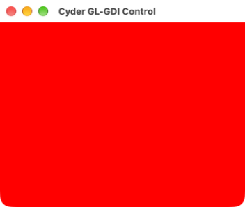
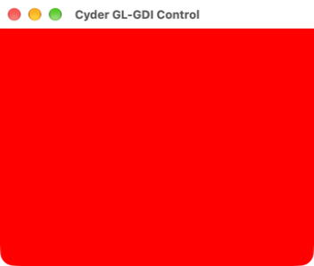
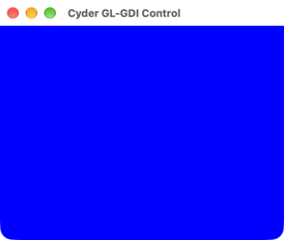
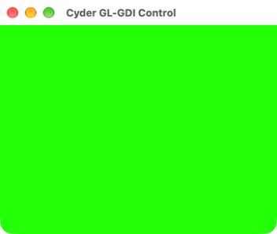
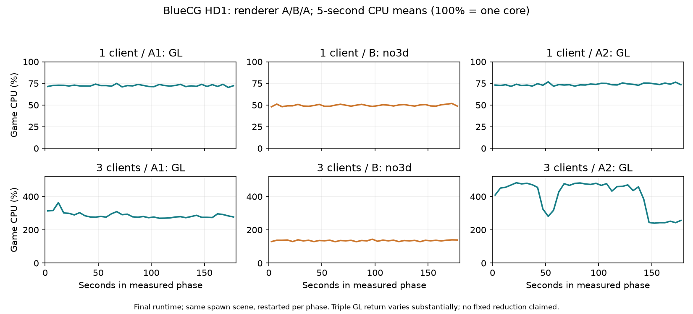
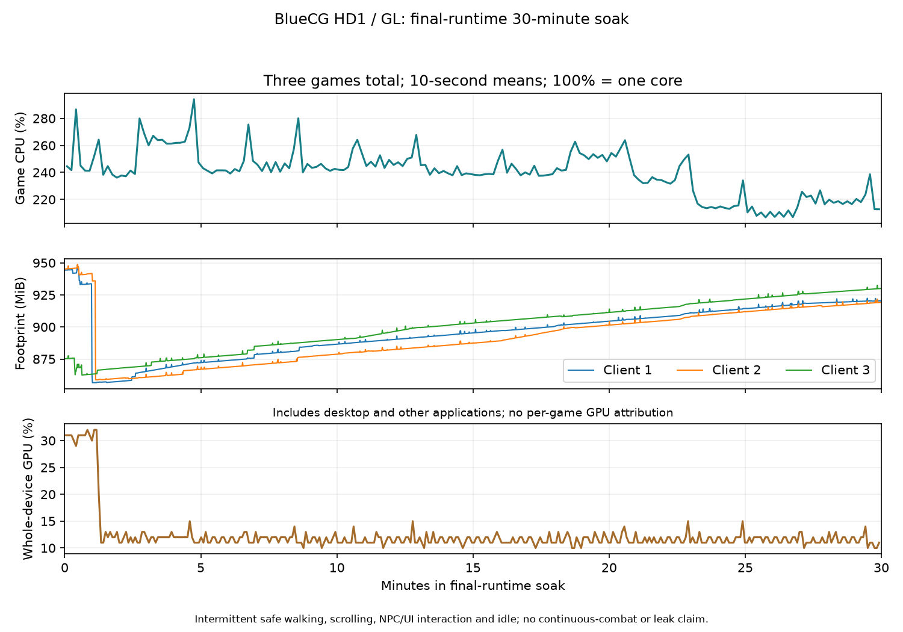

# PR #3：三遊戲驗證與 BlueCG 長時間量測

測試日期：2026-10-30～31（Asia/Taipei）。

本輪使用獨立診斷 runtime、三份 BlueCG 遊戲／prefix 副本，以及獨立女神／賽馬娘
prefix。未替換正式 Cyder runtime，未修改遊戲 DLL。帳密只從本機 `.env` 在記憶體
取用；原始截圖與日誌包含遊戲內文字，僅保留於私有暫存目錄，不納入 PR。

## 診斷範圍

新增 `CYDER_SURFACE_PROFILE=1`，補足 GL 計數無法描述的 GDI window-surface
更新。預設關閉時不配置 profiler、不讀時鐘、不輸出；啟用時每個 surface 使用固定
1 ms histogram，五秒聚合一次。主畫面與 128×128 輔助 surface 必須分開，後者的
閒置間隔不是遊戲長幀。

`tools/game-soak/monitor.py` 以 libproc 記錄每個測試引擎程序的 CPU、RSS、physical
footprint。CPU 時間以本機 Mach timebase 換算；100% 代表一個核心。GPU 為
IOAccelerator 的全機指標，不能歸因為某一個程序。`summarize.py` 保留遺失程序
計數，GPU 的重複快取樣本不重複計入統計；GDI histogram 分 PID 與畫面尺寸。

GDI 提交 wall time 不包含之前的 DirectDraw／WineD3D Blt 工作、非同步 GPU 完成
或螢幕掃描。提交間隔不是遊戲邏輯 frame，也不能直接標為 GPU 幀時間。

## 額外 native flush 的影響範圍

PR #2 的新增成本發生在 winemac OpenGL flush callback **帶有 GL_FLUSH_PRESENT**
時：native flushBuffer 後再 client_surface_present。若 DirectDraw primary Blt 的
實際路徑每次都畫到 GL front buffer 並 glFlush，便可能每次 Blt 都多走一次 native
呈現。耗時受 driver 排隊、同步、swap interval、視窗／drawable 狀態影響；不能用
函式名稱推定固定成本，也不能把整個 callback 的 wall time 都算成 GPU 執行時間。

一般只同步 context 的 callback 不應呈現，PR #3 的 62da9c02 前置修正已避免該誤用；
b3c408b3 則避免更新 interval 時丟掉同時存在的旗標。正常 double-buffer SwapBuffers
保留原本 native swap，不因每個不帶 PRESENT 的 callback 額外 swap。GDI window
surface，以及走 DXMT／DXVK 的呈現，不會因這段 winemac GL 分支直接增加 native
front flush；本輪 BlueCG HD1 實測正屬 native 計數為零的情況。

較好的預設做法是保留正確的呈現條件與順序，先以低負擔聚合量測辨識真正命中的
遊戲／模式。對已證明可接受畫質與視窗行為的純 2D 遊戲，才另評估遊戲限定的 no3d
recipe；本輪不修改全域政策。任意略過 flush、依固定時間合併多個 Blt，可能丟失
原應立即可見的 front-buffer 更新；目前沒有可用的通用遊戲 frame 邊界作此決策。

## 上游後續修改

- [b3c408b3](https://github.com/wine-mirror/wine/commit/b3c408b3c0b6a308c3f07951960c0d47ea87fece)：
  PR #3 已納入；更新 interval 時保留 PRESENT 等旗標，屬正確性修補。
- [1a1d1f3f](https://github.com/wine-mirror/wine/commit/1a1d1f3f382083c8afc8311762137582e028d6fc)
  （2026-08-11）：針對 b5ab3b15 的 GL/GDI 切換退化，GDI 更新時隱藏舊 client view。
  上游說明 Elite Dangerous 啟動器先用 D3D9 再用 GDI 時，舊 GL 畫面可能遮住 GDI，
  造成看似凍結。這不是 native flush 減量方案，應以混合呈現控制另外驗證。
- [1c144117](https://github.com/wine-mirror/wine/commit/1c144117a874dac1ab136fab23b809f4bc7e4a82)
  （2026-09-11）：切換 context 前提交 GL commands。這增加的是 GL command flush，
  並非刪除 Cocoa flushBuffer；且上游 context API 已與 CX26 分支不同，不能當作
  兩行即可無條件套用的效能最佳化。

不能以通用節流或固定「每幀只 flush 一次」取代 front-buffer 呈現：driver 沒有
可靠的遊戲 frame 邊界，多次 Blt 也可能需要立即可見。先確認實際分支與 renderer，
再決定遊戲限定的策略；不要因 HD 模式 1 沒走 native 呈現，就推論所有遊戲零成本。

## 功能驗證紀錄

- BlueCG：三個授權測試帳號能同時登入。新建免費測試角色，確認走動、地圖捲動、
  物品／狀態介面、NPC 對話、免費新手裝備與切圖。啟動器 2026.10.27.01，角色
  選擇畫面顯示系統版本 2026-10-29，使用 HD 模式 1、`3Ddevice:1`。
- 女神守護之約：由使用者指定的 NSTGO_TC.exe 準備獨立副本，官方更新完成，能
  顯示伺服器與登入介面。登入後驗證仍待測試帳號或使用者自行登入；不能據此宣稱
  完整遊戲驗收通過。
- 賽馬娘：獨立 prefix 能播放標題影片，顯示 3D 主頁，並依教學指定按鈕進入競賽
  介面及 NPC 對話。教學會限制未指定的操作，不能把該限制誤判為引擎輸入故障。
  測試啟動器補入 bundled GStreamer plugin/scanner 與測試專屬 registry 環境，並已
  以該修改後的啟動方式重驗，影片持續播放、3D 主頁及教學操作均可進行。

## BlueCG 前置版本三開 30 分鐘（GL、HD 模式 1）

Apple M4／macOS 27.2，實測取樣程序執行 **1,800.19 秒**。取得 1,795 個取樣列，
首末樣本相距 1,799.18 秒；排程間隔偶有超過一秒，因此不以列數替代測試時間。
三個預期遊戲 PID 的缺失樣本均為零。輪流走動、地圖捲動、物品／狀態介面、
NPC 對話與新手切圖，其餘時間為遊戲內停留及背景畫面更新；不是連續戰鬥測試。
結束截圖仍顯示三個角色在遊戲內，未見斷線對話或持續凍結，隨後正常退出。

| 指標 | 客戶端 1 | 客戶端 2 | 客戶端 3 |
|---|---:|---:|---:|
| CPU 平均／P95，100%=一核心 | 80.78%／98.94% | 87.69%／104.61% | 86.40%／102.65% |
| RSS 峰值，MiB | 241.31 | 237.08 | 313.37 |
| Physical footprint 起點→終點，MiB | 795.23→909.41 | 790.96→878.51 | 777.06→873.06 |
| Physical footprint 峰值，MiB | 909.41 | 880.08 | 874.06 |
| 主畫面 GDI 提交樣本 | 107,334 | 107,332 | 107,335 |
| 提交間隔 P50／P95／P99 上界，ms | 20／22／25 | 20／22／25 | 20／22／24 |
| 提交間隔 >50ms／>100ms 次數 | 81／6 | 78／8 | 73／5 |
| 平均一次 image create/submit wall time，µs | 19.76 | 17.76 | 16.55 |

三個遊戲逐樣本合計 CPU 平均 **254.87%**、P95 **302.67%**；全部測試引擎程序
合計平均 **256.76%**，其中三個 wineserver 合計平均 **1.66%**。IOAccelerator
全機 Device Utilization 359 個獨立樣本，平均 **11.19%**、P95 **12%**、最高 **14%**。
GPU 包含桌面、WindowServer 與擷取畫面等負載，沒有每個遊戲的 GPU 歸因。

GDI 統計只取 1024×768 主 surface，排除 128×128 輔助 surface，各丟棄跨起點的
首個聚合。主畫面有效 histogram 約 1,793.7 秒、每個客戶端 357 個完整聚合；末尾
未滿五秒不強行補值。長間隔包含操作、擷取與切圖，不能全數當成穩態渲染故障。
Footprint 有成長，但本段包含資源載入與切圖，沒有足夠證據把它判定為洩漏。

正常退出後核對 final 聚合：三個 run 各有 24、23、23 次 GL 同步 callback，
**native front flush、native swap 均為 0**，並有各主程序的 final rows。已核對
實際載入本次 runtime 的 win32u.so／winemac.so 與 builtin i386-windows
`ddraw.dll`／`wined3d.dll`／`opengl32.dll`。本模式的持續 CPU 成本不能歸因於
PR #2 新增的 native flush 分支。這仍不是每次完整 Blt 的 CPU／GPU 成本。

Renderer A/B/A 與混合 GL/GDI 回歸控制另列完成資料；不把尚未完成的測試計為通過。

## GL → GDI → GL 呈現退化與修正

以同一可見視窗各顯示十秒的 GL 紅、GDI 綠與重建 context 的 GL 藍。原版本
顯示紅／紅／藍，重現上游 1a1d1f3f 的遮蔽問題。回移上游修正後為紅／綠／紅：
GDI 恢復，但已隱藏的舊 GL view 使替換 context 延後到 viewWillDraw 才綁定，
第一張 GL 指令沒有 drawable，回切顯示舊內容。

新增窄範圍 `cyder-winemac-reattach-hidden-gl-client-view.patch`：只有曾使用 GL、
windowNumber>0、隱藏且 bounds 非空的既有 view，才在新 context 開始繪圖前綁定；
首次使用、尚未實現、零尺寸及其他裁切情況仍延後。修正後單次 SwapBuffers 即可
顯示紅／綠／藍，沒有用多次 redraw 掩蓋第一幀問題。

| 版本 | GL 紅 | GDI 綠 | 重建 context 的第一張 GL 藍 |
|---|---|---|---|
| 原版本 |  |  |  |
| 完整修正 |  |  |  |

控制程式為 `tools/gl-profile/gl-gdi-control.c`，連結 opengl32/gdi32/user32 後，
在獨立測試 prefix 執行。它的完成訊息不是像素斷言；上表是實際逐階段擷取的畫面。
回歸另編譯實際 GDI flush 與 Cocoa addGLContext 方法，確認缺少 data/view、shape
更新和原本各種延後條件。

30 分鐘資料來自修補前加有 profiler 的診斷引擎；不宣稱該段已驗證後來新增的
雙向切換修補。後續 renderer A/B/A 使用相同的完整修正版本，避免交叉比較不同引擎。

## 最終引擎與功能回歸

標準 configure/apply 重跑成功；兩個 host 模組為 x86_64、minOS 10.15，診斷
runtime 的 ad-hoc 簽章 strict 驗證通過。win32u.so SHA-256 為
`26f799043303a9575b4336b6b4d95932e4c20c1f90777c203a26c55f1276e0f6`，
完整呈現修正的 winemac.so 為
`950e9b2d364c9b728750bdc6d4c579906bf25ec12892ac5c9029bf8fc4cfb7f0`。
只增量重建兩個 host 模組及 link 依賴，沿用既有診斷 runtime 的 media/TLS 等
payload；不是完整 shipping build 或發布包。

`tests/run.sh` exit 0：53 個 Shell entrypoints、27 個 Python unit tests。
只有既有 optional MoltenVK live source round-trip 因缺少 patched MVKSync.mm
跳過，對應 content checks 通過。新增實際 GDI flush／Cocoa 方法、profiler
histogram／邊界、Mach CPU 換算、GPU 去重及測試啟動器媒體環境回歸均通過。

真實隱藏視窗控制在一般版精確計到 8 native front flush／8 native swaps。另建的
診斷版只略過 native front flush，保持一般 swap 及 client present；同一控制精確
計到 0／8。這個變體未作產品預設或發布；它驗證控制分支，不是遊戲效能改善證據。
BlueCG HD 模式 1 原本沒有觸發該分支，移除它不能解釋本模式的持續 CPU 成本。

賽馬娘 Ver.2.18.6-10300 已用 PR 中的 `prepare-media-environment.sh` 重驗，移除
臨時手動 GST／DYLD 配置。兩張不同時點的標題畫面確認影片持續播放；進入 3D
主頁後，教學指定按鈕可進入競賽與 NPC 對話。實際載入本引擎 DXMT 的
d3d11.dll、dxgi.dll、winemetal.dll／so，以及 winegstreamer.dll／so 和 bundled
libgstreamer。未進行消費、抽卡或付費操作。測試副本已關閉。

女神重新完成官方 exe_aLogin.zip 更新，以最終引擎進入 Terra 分流選擇及帳密
登入介面，圖像與按鈕操作正常。未取得 NSTGO 測試帳號，登入後內容仍未驗收；
不能把登入介面通過寫成完整遊戲通過。測試副本已停止以隔離效能取樣。

## Issue #15：單開 GL → no3d → GL

同一個最終引擎、HD 模式 1／3Ddevice:1、同一測試角色，在每段重啟後回到
召喚之間的相同出生點，暖機至少 30 秒，再各取三分鐘定點資料。Windows API
實測 client 961×721、96 DPI，macOS 視窗 961×753，GDI allocation 1024×768；
未混用遊戲的 3Ddevice:0 或更換 HD 啟動模式。其餘兩款遊戲已停止。
日誌分別確認 Using the OpenGL renderer／Disabling 3D support／Using the OpenGL renderer。

| 單開段 | 遊戲 CPU 平均／P95 | GDI 提交間隔 P95／P99 上界，ms |
|---|---:|---:|
| A1：GL | 72.46%／75.51% | 22／24 |
| B：no3d | 49.63%／52.28% | 22／23 |
| A2：GL | 73.80%／77.39% | 23／25 |

三段分別實測 180.59、180.59、180.77 秒，預期遊戲 PID 缺失樣本均為零。
相對兩個 GL 段平均，no3d 遊戲 CPU 降低約 **32.1%**；切回 GL 後負擔回升，
支持此環境的 renderer 因果對照。主畫面仍約每秒提交 60 次，P95 差異只有
1 ms histogram 的一個桶，不能據此宣稱 GPU 幀時間、輸入延遲或 FPS 改善。

這不是原回報「三開 160%→50%」的直接重現：本輪為 M4、目前客戶端、HD 模式 1、
新角色與獨立遊戲／prefix 副本。多人城鎮、戰鬥特效、其他模式及其他機器仍需
各自對照；也沒有拿較舊客戶端去證明某一次官方更新就是卡頓起點。

## Issue #15：三開 GL → no3d → GL

三份相同 hash 的遊戲檔、三個授權測試帳號，在每段重啟後回到召喚之間的出生點，
第三個客戶端在前景，其餘視窗重疊；每段暖機至少 30 秒。模式、DPI、視窗及引擎
與單開對照相同，其他測試遊戲停止。三段實測時間為 180.54／180.51／180.59 秒，
每段均有 179 個有效 CPU 差分樣本，三個遊戲 PID 均無缺失樣本。

| 三開段 | 遊戲合計 CPU 平均／P95 | 全引擎 CPU 平均 | wineserver 合計平均 | 各主 surface 提交間隔 P95／P99 上界，ms |
|---|---:|---:|---:|---|
| A1：GL | 286.99%／326.95% | 289.11% | 1.66% | 22／23、21／24、25／26 |
| B：no3d | 135.09%／144.67% | 136.59% | 1.44% | 22／22、22／22、22／22 |
| A2：GL | 405.52%／483.95% | 408.06% | 2.10% | 21／25、21／25、21／25 |

no3d 低於兩次 GL，但 GL 回切不是回到同一負載：A2 的六個 30 秒區間平均合計
CPU 約 459／388／468／465／409／246%，A1 約 314／283／291／274／279／283%。
因此保留三段原數值，不以兩個 GL 的平均製造單一穩定改善百分比，也不把原回報
160%→50% 當成本輪直接重現。需要跨日／原回報機器重測及更完整的外部負載控制，
才能訂出可普遍使用的效能數字。

全機 GPU Device Utilization 平均 A1／B／A2 為 11.14%／11.47%／49.31%，A2 P95
66%。這項指標含桌面及其他應用，且段間明顯波動，不能用來宣稱每個遊戲的 GPU
改善，或將讀回推定為已證實根因。GDI >50ms 次數為 A1 的 6／6／8、B 的 0／0／0、
A2 的 10／10／10；A2 >100ms 為 2／1／3。這些是提交間隔，仍不是 GPU 幀時間。

| 每個客戶端的平均 CPU | 客戶端 1 | 客戶端 2 | 客戶端 3 |
|---|---:|---:|---:|
| A1：GL | 96.08% | 96.48% | 94.44% |
| B：no3d | 44.77% | 44.76% | 45.55% |

B 段平均 physical footprint 為 645.62／651.34／651.63 MiB，A1 為
804.48／797.94／794.37 MiB；這是重啟後固定場景的取樣平均，不能外推成常駐記憶體
或洩漏結論。RSS 與 footprint 是不同統計，不能相加。

在 B 段計時結束後，Windows API 最小化／還原確認 IsIconic 為 0→1→0，畫面重新
更新，client 仍為 961×721、96 DPI。Alt+Enter 兩次送出後，未觀察到全螢幕切換；
此操作只記為切換未驗證，不計為全螢幕驗收通過。獨立 prefix 的部分原生確認／更新對話仍有中文字型缺字；主要遊戲介面中文字可見。
未對縮放／Retina 模式作完整驗收，
也未據本輪資料改動全域 renderer 或正式 CompatDB recipe。

三份 `bluecg.exe` SHA-256 均為
`54196345594f5f7c9e1e8b586736cc371780b1cbd3b7cfe470ba12f8c66a77c8`；
`BlueLauncher.exe` 均為
`414682a18d61b06d02195fe2e2f006b1e631ba1fa00087024a396d710d0dd70f`。
這只標識本輪檔案，不證明某次官方更新就是回歸起點。

## 最終引擎三開 30 分鐘遊玩與穩定度

完整雙向 GL/GDI 修正後，以相同三個角色及 GL／HD1 進行獨立 30 分鐘段。
實測 1,800.12 秒，1,795 個取樣列，首末樣本跨度 1,799.11 秒；首列無 CPU 差分，
有效 CPU 樣本 1,794 個。三個預期遊戲 PID 的缺失樣本均為零。輪流做安全走動、
地圖捲動、物品／狀態介面及 NPC 對話，第一角色由召喚之間切入迴廊後繼續走動，
其餘時間遊戲內停留；不是連續戰鬥或多人高負載場景測試。

| 指標 | 客戶端 1 | 客戶端 2 | 客戶端 3 |
|---|---:|---:|---:|
| CPU 平均／P95，100%=一核心 | 77.00%／91.59% | 82.05%／92.19% | 81.06%／94.37% |
| RSS 取樣峰值，MiB | 280.70 | 275.47 | 276.45 |
| Physical footprint 起點→終點，MiB | 943.87→920.41 | 945.18→919.20 | 874.98→930.00 |
| Physical footprint 取樣峰值，MiB | 946.78 | 948.67 | 932.48 |
| 主畫面 GDI 提交樣本 | 107,525 | 107,528 | 107,548 |
| 提交間隔 P50／P95／P99 上界，ms | 20／21／23 | 20／22／23 | 20／22／23 |
| 提交間隔 >50ms／>100ms 次數 | 33／1 | 34／0 | 28／1 |
| 平均 image create/submit wall time，µs | 16.76 | 15.94 | 18.12 |

逐樣本遊戲合計 CPU 平均 240.11%、P95 275.01%；全部引擎程序平均 241.68%，
其中三個 wineserver 合計平均 1.49%。IOAccelerator 全機 GPU Device Utilization
359 個獨立樣本，平均 12.43%、P95 15%、最高 32%；仍不代表每個遊戲的 GPU 使用率。

主 surface 每個客戶端取 357 個完整聚合、約 1,793.9 秒 histogram，依原協定捨棄
跨起點首個聚合及未報尾段，128×128 輔助 surface 不混入。這些操作期間的長提交
間隔不是定點幀時間；16–18µs 的 image create/submit 也不是完整 Blt 成本。

Footprint 前段曾回落，之後再成長，第三客戶端起終點增加約 55 MiB；本段含資源
載入、介面及切圖，回落後三者仍呈同向緩增，值得後續固定場景更長時間追蹤；
沒有足夠證據判定洩漏或保證無洩漏。CPU 也不能直接與前置版本
長測作修補效能差異：操作時序、暖機與背景負載不同。

結束畫面三個角色仍在遊戲內，未見斷線或持續凍結，隨後逐一正常退出，確認遊戲
程序退出後才停止該 prefix 的殘留啟動器與 wineserver。final 聚合包含各主程序，
完整 run 的 GL 同步 callbacks 分別 18／18／17 次，native front flush／swap
仍均為零。這一輪才是完整呈現修正後的 30 分鐘驗證；前置版本資料另列保留。

在取樣結束後補驗 GL 最小化／還原，IsIconic 0→1→0、畫面恢復更新，Windows
client 961×721、96 DPI。與 no3d 的對照都保留此尺寸；全螢幕／Retina 仍未完整驗收。
測試使用的三個 BlueCG prefix 已停止，恢復原 macOS 輸入法。

圖為每五秒 CPU 平均，可看出三開 GL 回切的波動；不主張固定改善率。

CPU 為三個遊戲合計的十秒平均；footprint 分客戶端；GPU 為全機獨立觀測。
圖中不含遊戲畫面、角色／帳號、聊天或網路識別資訊。
