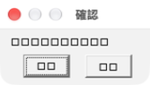
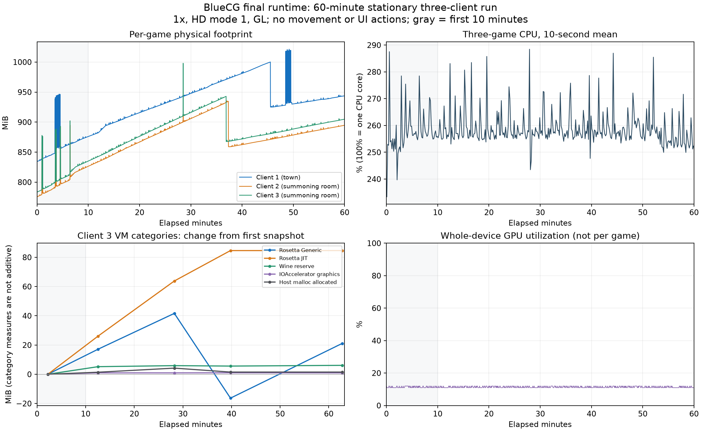

# PR #3：三遊戲驗證與 BlueCG 長時間量測

測試日期：2026-10-30～11-01（Asia/Taipei）。

本輪使用獨立診斷 runtime、三份 BlueCG 遊戲／prefix 副本，以及獨立女神／賽馬娘
prefix。未替換正式 Cyder runtime，未修改遊戲 DLL。帳密只從本機 `.env` 在記憶體
取用；原始遊戲截圖與日誌包含遊戲內文字，僅保留於私有暫存目錄，不納入 PR；
本文只附無帳號／角色資訊的原生字型裁圖及彙總量測圖。

## 目前驗收快照（2026-11-01）

| 項目 | 已實際驗證 | 尚未驗證／限制 |
|---|---|---|
| 水藍魔力 | 兩場戰鬥勝利、一次逃走、戒指／國王流程、城堡與法蘭城多人場景；原生中文方框以既有宋體配置修正；真實 2x Retina、雙向 Alt+Enter、連續縮放、1x／2x 各三次最小化還原；三開固定位置 3,600.93 秒，主程序缺失 0 | Alt+Enter 首次切回有 8×5 points 偏差，後續不累增；非 exclusive fullscreen；footprint 自然回收但最後十分鐘仍緩增，不能保證無洩漏；原生 macOS 全螢幕退出有裁切／退出失敗，另由 engine #4 追蹤；室內 no3d／GL／no3d 對照僅閒置負載 |
| 賽馬娘 | 標題影片、3D 主頁、教學編成；草地／沙地 1800m 兩場完整播放至名次結算；同組五場總結算 WIN 73,537 pt；DXMT／GStreamer 實際載入 | 第 3～5 場僅觀看結果；未涵蓋所有模式與長時間穩定度 |
| 女神守護之約 | 官方更新、註冊、免費創角、住宅走動／捲圖、NPC 對話、介面教學問答、狀態背包、出口劇情切圖；戰鬥第 1～6 回合；600.24 秒取樣與正常登出 | 普通攻擊傷害與完整戰鬥結算未確認；長時間穩定度待測，不能宣稱完整遊戲驗收通過 |
| GL/GDI 修正 | 原可見控制紅／紅／藍；完整修正後單次 swap 顯示紅／綠／藍；實際 C／Cocoa 方法回歸通過 | 非所有遊戲、模式及桌面設定的通用驗收 |
| 建置／自動回歸 | 兩個 host 模組 x86_64／minOS 10.15、strict ad-hoc 簽章；53 Shell entrypoints + 27 Python tests 通過 | 既有 optional MoltenVK live-source round-trip 因缺少來源跳過，content checks 通過；不是 shipping build／發布包 |

BlueCG 最新一小時固定位置三開，遊戲合計 CPU 平均／P95 為
**258.59%／274.07%**（100%=一核心），全機 GPU 平均 **11.38%**。
Footprint 增長包含 Rosetta Generic／JIT 分類的變化與自然回收；最後十分鐘仍
緩增，不能宣稱已平台或無洩漏。原先三開 GL／no3d／GL 的回切漂移仍保留為
歷史限制；本輪以相同室內位置兩開完成 no3d／GL／no3d：CPU 平均
88.69%／147.69%／88.50%，no3d 前後差約 0.21%；只限本場景，詳見文末。

女神測試帳密已依使用者要求存於本機既有 `.env` 的 `NSTGO_USERNAME`／
`NSTGO_PASSWORD`，權限 0600、Git 忽略。文件、圖表與 PR 不包含帳密，遊戲原始
截圖／日誌維持私有。此處的「註冊成功」以送出後實際到達角色選擇為據，不把僅
送出表單視為成功。

以下保留診斷細節、前置版本與最終版本各自的量測、原始結論邊界。

## 診斷範圍

新增 `CYDER_SURFACE_PROFILE=1`，補足 GL 計數無法描述的 GDI window-surface
更新。預設關閉時不配置 profiler、不讀時鐘、不輸出；啟用時每個 surface 使用固定
1 ms histogram，五秒聚合一次。主畫面與 128×128 輔助 surface 必須分開，後者的
閒置間隔不是遊戲長幀。

`tools/game-soak/monitor.py` 以 libproc 記錄每個測試引擎程序的 CPU、RSS、physical
footprint。CPU 時間以本機 Mach timebase 換算；100% 代表一個核心。GPU 為
IOAccelerator 的全機指標，不能歸因為某一個程序。`summarize.py` 保留遺失程序
計數，GPU 的重複快取樣本不重複計入統計；GDI histogram 分 PID 與畫面尺寸。

GDI 提交 wall time 不包含之前的 DirectDraw／WineD3D Blt 工作、非同步 GPU 完成
或螢幕掃描。提交間隔不是遊戲邏輯 frame，也不能直接標為 GPU 幀時間。

## 額外 native flush 的影響範圍

PR #2 的新增成本發生在 winemac OpenGL flush callback **帶有 GL_FLUSH_PRESENT**
時：native flushBuffer 後再 client_surface_present。若 DirectDraw primary Blt 的
實際路徑每次都畫到 GL front buffer 並 glFlush，便可能每次 Blt 都多走一次 native
呈現。耗時受 driver 排隊、同步、swap interval、視窗／drawable 狀態影響；不能用
函式名稱推定固定成本，也不能把整個 callback 的 wall time 都算成 GPU 執行時間。

一般只同步 context 的 callback 不應呈現，PR #3 的 62da9c02 前置修正已避免該誤用；
b3c408b3 則避免更新 interval 時丟掉同時存在的旗標。正常 double-buffer SwapBuffers
保留原本 native swap，不因每個不帶 PRESENT 的 callback 額外 swap。GDI window
surface，以及走 DXMT／DXVK 的呈現，不會因這段 winemac GL 分支直接增加 native
front flush；本輪 BlueCG HD1 實測正屬 native 計數為零的情況。

較好的預設做法是保留正確的呈現條件與順序，先以低負擔聚合量測辨識真正命中的
遊戲／模式。對已證明可接受畫質與視窗行為的純 2D 遊戲，才另評估遊戲限定的 no3d
recipe；本輪不修改全域政策。任意略過 flush、依固定時間合併多個 Blt，可能丟失
原應立即可見的 front-buffer 更新；目前沒有可用的通用遊戲 frame 邊界作此決策。

## 上游後續修改

- [b3c408b3](https://github.com/wine-mirror/wine/commit/b3c408b3c0b6a308c3f07951960c0d47ea87fece)：
  PR #3 已納入；更新 interval 時保留 PRESENT 等旗標，屬正確性修補。
- [1a1d1f3f](https://github.com/wine-mirror/wine/commit/1a1d1f3f382083c8afc8311762137582e028d6fc)
  （2026-08-11）：針對 b5ab3b15 的 GL/GDI 切換退化，GDI 更新時隱藏舊 client view。
  上游說明 Elite Dangerous 啟動器先用 D3D9 再用 GDI 時，舊 GL 畫面可能遮住 GDI，
  造成看似凍結。這不是 native flush 減量方案，應以混合呈現控制另外驗證。
- [1c144117](https://github.com/wine-mirror/wine/commit/1c144117a874dac1ab136fab23b809f4bc7e4a82)
  （2026-09-11）：切換 context 前提交 GL commands。這增加的是 GL command flush，
  並非刪除 Cocoa flushBuffer；且上游 context API 已與 CX26 分支不同，不能當作
  兩行即可無條件套用的效能最佳化。

不能以通用節流或固定「每幀只 flush 一次」取代 front-buffer 呈現：driver 沒有
可靠的遊戲 frame 邊界，多次 Blt 也可能需要立即可見。先確認實際分支與 renderer，
再決定遊戲限定的策略；不要因 HD 模式 1 沒走 native 呈現，就推論所有遊戲零成本。

## 功能驗證紀錄

- BlueCG：三個授權測試帳號能同時登入。新建免費測試角色，確認走動、地圖捲動、
  物品／狀態介面、NPC 對話、免費新手裝備與切圖。啟動器 2026.10.27.01，角色
  選擇畫面顯示系統版本 2026-10-29，使用 HD 模式 1、`3Ddevice:1`。
- 女神守護之約：由使用者指定的 NSTGO_TC.exe 準備獨立副本，官方更新完成，能
  顯示伺服器與登入介面。後續依使用者要求在遊戲內完成註冊並進入角色選擇；
  續測已補驗創角、住宅走動、NPC、狀態背包與劇情戰鬥回合；完整結算與長時間
  穩定度仍未驗收，不能據此宣稱完整遊戲驗收通過。
- 賽馬娘：獨立 prefix 能播放標題影片，顯示 3D 主頁，並依教學指定按鈕進入競賽
  介面及 NPC 對話。教學會限制未指定的操作，不能把該限制誤判為引擎輸入故障。
  測試啟動器補入 bundled GStreamer plugin/scanner 與測試專屬 registry 環境，並已
  以該修改後的啟動方式重驗，影片持續播放、3D 主頁及教學操作均可進行。

## BlueCG 前置版本三開 30 分鐘（GL、HD 模式 1）

Apple M4／macOS 27.2，實測取樣程序執行 **1,800.19 秒**。取得 1,795 個取樣列，
首末樣本相距 1,799.18 秒；排程間隔偶有超過一秒，因此不以列數替代測試時間。
三個預期遊戲 PID 的缺失樣本均為零。輪流走動、地圖捲動、物品／狀態介面、
NPC 對話與新手切圖，其餘時間為遊戲內停留及背景畫面更新；不是連續戰鬥測試。
結束截圖仍顯示三個角色在遊戲內，未見斷線對話或持續凍結，隨後正常退出。

| 指標 | 客戶端 1 | 客戶端 2 | 客戶端 3 |
|---|---:|---:|---:|
| CPU 平均／P95，100%=一核心 | 80.78%／98.94% | 87.69%／104.61% | 86.40%／102.65% |
| RSS 峰值，MiB | 241.31 | 237.08 | 313.37 |
| Physical footprint 起點→終點，MiB | 795.23→909.41 | 790.96→878.51 | 777.06→873.06 |
| Physical footprint 峰值，MiB | 909.41 | 880.08 | 874.06 |
| 主畫面 GDI 提交樣本 | 107,334 | 107,332 | 107,335 |
| 提交間隔 P50／P95／P99 上界，ms | 20／22／25 | 20／22／25 | 20／22／24 |
| 提交間隔 >50ms／>100ms 次數 | 81／6 | 78／8 | 73／5 |
| 平均一次 image create/submit wall time，µs | 19.76 | 17.76 | 16.55 |

三個遊戲逐樣本合計 CPU 平均 **254.87%**、P95 **302.67%**；全部測試引擎程序
合計平均 **256.76%**，其中三個 wineserver 合計平均 **1.66%**。IOAccelerator
全機 Device Utilization 359 個獨立樣本，平均 **11.19%**、P95 **12%**、最高 **14%**。
GPU 包含桌面、WindowServer 與擷取畫面等負載，沒有每個遊戲的 GPU 歸因。

GDI 統計只取 1024×768 主 surface，排除 128×128 輔助 surface，各丟棄跨起點的
首個聚合。主畫面有效 histogram 約 1,793.7 秒、每個客戶端 357 個完整聚合；末尾
未滿五秒不強行補值。長間隔包含操作、擷取與切圖，不能全數當成穩態渲染故障。
Footprint 有成長，但本段包含資源載入與切圖，沒有足夠證據把它判定為洩漏。

正常退出後核對 final 聚合：三個 run 各有 24、23、23 次 GL 同步 callback，
**native front flush、native swap 均為 0**，並有各主程序的 final rows。已核對
實際載入本次 runtime 的 win32u.so／winemac.so 與 builtin i386-windows
`ddraw.dll`／`wined3d.dll`／`opengl32.dll`。本模式的持續 CPU 成本不能歸因於
PR #2 新增的 native flush 分支。這仍不是每次完整 Blt 的 CPU／GPU 成本。

Renderer A/B/A 與混合 GL/GDI 回歸控制另列完成資料；不把尚未完成的測試計為通過。

## GL → GDI → GL 呈現退化與修正

以同一可見視窗各顯示十秒的 GL 紅、GDI 綠與重建 context 的 GL 藍。原版本
顯示紅／紅／藍，重現上游 1a1d1f3f 的遮蔽問題。回移上游修正後為紅／綠／紅：
GDI 恢復，但已隱藏的舊 GL view 使替換 context 延後到 viewWillDraw 才綁定，
第一張 GL 指令沒有 drawable，回切顯示舊內容。

新增窄範圍 `cyder-winemac-reattach-hidden-gl-client-view.patch`：只有曾使用 GL、
windowNumber>0、隱藏且 bounds 非空的既有 view，才在新 context 開始繪圖前綁定；
首次使用、尚未實現、零尺寸及其他裁切情況仍延後。修正後單次 SwapBuffers 即可
顯示紅／綠／藍，沒有用多次 redraw 掩蓋第一幀問題。

| 版本 | GL 紅 | GDI 綠 | 重建 context 的第一張 GL 藍 |
|---|---|---|---|
| 原版本 |  |  |  |
| 完整修正 |  |  |  |

控制程式為 `tools/gl-profile/gl-gdi-control.c`，連結 opengl32/gdi32/user32 後，
在獨立測試 prefix 執行。它的完成訊息不是像素斷言；上表是實際逐階段擷取的畫面。
回歸另編譯實際 GDI flush 與 Cocoa addGLContext 方法，確認缺少 data/view、shape
更新和原本各種延後條件。

30 分鐘資料來自修補前加有 profiler 的診斷引擎；不宣稱該段已驗證後來新增的
雙向切換修補。後續 renderer A/B/A 使用相同的完整修正版本，避免交叉比較不同引擎。

## 最終引擎與功能回歸

標準 configure/apply 重跑成功；兩個 host 模組為 x86_64、minOS 10.15，診斷
runtime 的 ad-hoc 簽章 strict 驗證通過。win32u.so SHA-256 為
`26f799043303a9575b4336b6b4d95932e4c20c1f90777c203a26c55f1276e0f6`，
完整呈現修正的 winemac.so 為
`950e9b2d364c9b728750bdc6d4c579906bf25ec12892ac5c9029bf8fc4cfb7f0`。
只增量重建兩個 host 模組及 link 依賴，沿用既有診斷 runtime 的 media/TLS 等
payload；不是完整 shipping build 或發布包。

`tests/run.sh` exit 0：53 個 Shell entrypoints、27 個 Python unit tests。
只有既有 optional MoltenVK live source round-trip 因缺少 patched MVKSync.mm
跳過，對應 content checks 通過。新增實際 GDI flush／Cocoa 方法、profiler
histogram／邊界、Mach CPU 換算、GPU 去重及測試啟動器媒體環境回歸均通過。

真實隱藏視窗控制在一般版精確計到 8 native front flush／8 native swaps。另建的
診斷版只略過 native front flush，保持一般 swap 及 client present；同一控制精確
計到 0／8。這個變體未作產品預設或發布；它驗證控制分支，不是遊戲效能改善證據。
BlueCG HD 模式 1 原本沒有觸發該分支，移除它不能解釋本模式的持續 CPU 成本。

賽馬娘 Ver.2.18.6-10300 已用 PR 中的 `prepare-media-environment.sh` 重驗，移除
臨時手動 GST／DYLD 配置。兩張不同時點的標題畫面確認影片持續播放；進入 3D
主頁後，教學指定按鈕可進入競賽與 NPC 對話。實際載入本引擎 DXMT 的
d3d11.dll、dxgi.dll、winemetal.dll／so，以及 winegstreamer.dll／so 和 bundled
libgstreamer。未進行消費、抽卡或付費操作。測試副本已關閉。

女神重新完成官方 exe_aLogin.zip 更新，以最終引擎進入 Terra 分流選擇及帳密
登入介面，圖像與按鈕操作正常。先停止副本以隔離 BlueCG 效能取樣，完成量測後
重新開啟，依使用者要求申請測試帳號；註冊後已進入角色選擇，帳密保存於本機
`.env`。創角後續測已補驗住宅、NPC、背包與劇情戰鬥回合，詳見下方續測紀錄；完整戰鬥與長時間穩定度仍待驗收。

## Issue #15：單開 GL → no3d → GL

同一個最終引擎、HD 模式 1／3Ddevice:1、同一測試角色，在每段重啟後回到
召喚之間的相同出生點，暖機至少 30 秒，再各取三分鐘定點資料。Windows API
實測 client 961×721、96 DPI，macOS 視窗 961×753，GDI allocation 1024×768；
未混用遊戲的 3Ddevice:0 或更換 HD 啟動模式。其餘兩款遊戲已停止。
日誌分別確認 Using the OpenGL renderer／Disabling 3D support／Using the OpenGL renderer。

| 單開段 | 遊戲 CPU 平均／P95 | GDI 提交間隔 P95／P99 上界，ms |
|---|---:|---:|
| A1：GL | 72.46%／75.51% | 22／24 |
| B：no3d | 49.63%／52.28% | 22／23 |
| A2：GL | 73.80%／77.39% | 23／25 |

三段分別實測 180.59、180.59、180.77 秒，預期遊戲 PID 缺失樣本均為零。
相對兩個 GL 段平均，no3d 遊戲 CPU 降低約 **32.1%**；切回 GL 後負擔回升，
支持此環境的 renderer 因果對照。主畫面仍約每秒提交 60 次，P95 差異只有
1 ms histogram 的一個桶，不能據此宣稱 GPU 幀時間、輸入延遲或 FPS 改善。

這不是原回報「三開 160%→50%」的直接重現：本輪為 M4、目前客戶端、HD 模式 1、
新角色與獨立遊戲／prefix 副本。多人城鎮、戰鬥特效、其他模式及其他機器仍需
各自對照；也沒有拿較舊客戶端去證明某一次官方更新就是卡頓起點。

## Issue #15：三開 GL → no3d → GL

三份相同 hash 的遊戲檔、三個授權測試帳號，在每段重啟後回到召喚之間的出生點，
第三個客戶端在前景，其餘視窗重疊；每段暖機至少 30 秒。模式、DPI、視窗及引擎
與單開對照相同，其他測試遊戲停止。三段實測時間為 180.54／180.51／180.59 秒，
每段均有 179 個有效 CPU 差分樣本，三個遊戲 PID 均無缺失樣本。

| 三開段 | 遊戲合計 CPU 平均／P95 | 全引擎 CPU 平均 | wineserver 合計平均 | 各主 surface 提交間隔 P95／P99 上界，ms |
|---|---:|---:|---:|---|
| A1：GL | 286.99%／326.95% | 289.11% | 1.66% | 22／23、21／24、25／26 |
| B：no3d | 135.09%／144.67% | 136.59% | 1.44% | 22／22、22／22、22／22 |
| A2：GL | 405.52%／483.95% | 408.06% | 2.10% | 21／25、21／25、21／25 |

no3d 低於兩次 GL，但 GL 回切不是回到同一負載：A2 的六個 30 秒區間平均合計
CPU 約 459／388／468／465／409／246%，A1 約 314／283／291／274／279／283%。
因此保留三段原數值，不以兩個 GL 的平均製造單一穩定改善百分比，也不把原回報
160%→50% 當成本輪直接重現。需要跨日／原回報機器重測及更完整的外部負載控制，
才能訂出可普遍使用的效能數字。

全機 GPU Device Utilization 平均 A1／B／A2 為 11.14%／11.47%／49.31%，A2 P95
66%。這項指標含桌面及其他應用，且段間明顯波動，不能用來宣稱每個遊戲的 GPU
改善，或將讀回推定為已證實根因。GDI >50ms 次數為 A1 的 6／6／8、B 的 0／0／0、
A2 的 10／10／10；A2 >100ms 為 2／1／3。這些是提交間隔，仍不是 GPU 幀時間。

| 每個客戶端的平均 CPU | 客戶端 1 | 客戶端 2 | 客戶端 3 |
|---|---:|---:|---:|
| A1：GL | 96.08% | 96.48% | 94.44% |
| B：no3d | 44.77% | 44.76% | 45.55% |

B 段平均 physical footprint 為 645.62／651.34／651.63 MiB，A1 為
804.48／797.94／794.37 MiB；這是重啟後固定場景的取樣平均，不能外推成常駐記憶體
或洩漏結論。RSS 與 footprint 是不同統計，不能相加。

在 B 段計時結束後，Windows API 最小化／還原確認 IsIconic 為 0→1→0，畫面重新
更新，client 仍為 961×721、96 DPI。Alt+Enter 兩次送出後，未觀察到全螢幕切換；
此操作只記為切換未驗證，不計為全螢幕驗收通過。獨立 prefix 的部分原生確認／更新對話仍有中文字型缺字；主要遊戲介面中文字可見。
未對縮放／Retina 模式作完整驗收，
也未據本輪資料改動全域 renderer 或正式 CompatDB recipe。

三份 `bluecg.exe` SHA-256 均為
`54196345594f5f7c9e1e8b586736cc371780b1cbd3b7cfe470ba12f8c66a77c8`；
`BlueLauncher.exe` 均為
`414682a18d61b06d02195fe2e2f006b1e631ba1fa00087024a396d710d0dd70f`。
這只標識本輪檔案，不證明某次官方更新就是回歸起點。

## 最終引擎三開 30 分鐘遊玩與穩定度

完整雙向 GL/GDI 修正後，以相同三個角色及 GL／HD1 進行獨立 30 分鐘段。
實測 1,800.12 秒，1,795 個取樣列，首末樣本跨度 1,799.11 秒；首列無 CPU 差分，
有效 CPU 樣本 1,794 個。三個預期遊戲 PID 的缺失樣本均為零。輪流做安全走動、
地圖捲動、物品／狀態介面及 NPC 對話，第一角色由召喚之間切入迴廊後繼續走動，
其餘時間遊戲內停留；不是連續戰鬥或多人高負載場景測試。

| 指標 | 客戶端 1 | 客戶端 2 | 客戶端 3 |
|---|---:|---:|---:|
| CPU 平均／P95，100%=一核心 | 77.00%／91.59% | 82.05%／92.19% | 81.06%／94.37% |
| RSS 取樣峰值，MiB | 280.70 | 275.47 | 276.45 |
| Physical footprint 起點→終點，MiB | 943.87→920.41 | 945.18→919.20 | 874.98→930.00 |
| Physical footprint 取樣峰值，MiB | 946.78 | 948.67 | 932.48 |
| 主畫面 GDI 提交樣本 | 107,525 | 107,528 | 107,548 |
| 提交間隔 P50／P95／P99 上界，ms | 20／21／23 | 20／22／23 | 20／22／23 |
| 提交間隔 >50ms／>100ms 次數 | 33／1 | 34／0 | 28／1 |
| 平均 image create/submit wall time，µs | 16.76 | 15.94 | 18.12 |

逐樣本遊戲合計 CPU 平均 240.11%、P95 275.01%；全部引擎程序平均 241.68%，
其中三個 wineserver 合計平均 1.49%。IOAccelerator 全機 GPU Device Utilization
359 個獨立樣本，平均 12.43%、P95 15%、最高 32%；仍不代表每個遊戲的 GPU 使用率。

主 surface 每個客戶端取 357 個完整聚合、約 1,793.9 秒 histogram，依原協定捨棄
跨起點首個聚合及未報尾段，128×128 輔助 surface 不混入。這些操作期間的長提交
間隔不是定點幀時間；16–18µs 的 image create/submit 也不是完整 Blt 成本。

Footprint 前段曾回落，之後再成長，第三客戶端起終點增加約 55 MiB；本段含資源
載入、介面及切圖，回落後三者仍呈同向緩增，值得後續固定場景更長時間追蹤；
沒有足夠證據判定洩漏或保證無洩漏。CPU 也不能直接與前置版本
長測作修補效能差異：操作時序、暖機與背景負載不同。

結束畫面三個角色仍在遊戲內，未見斷線或持續凍結，隨後逐一正常退出，確認遊戲
程序退出後才停止該 prefix 的殘留啟動器與 wineserver。final 聚合包含各主程序，
完整 run 的 GL 同步 callbacks 分別 18／18／17 次，native front flush／swap
仍均為零。這一輪才是完整呈現修正後的 30 分鐘驗證；前置版本資料另列保留。

在取樣結束後補驗 GL 最小化／還原，IsIconic 0→1→0、畫面恢復更新，Windows
client 961×721、96 DPI。與 no3d 的對照都保留此尺寸；全螢幕／Retina 仍未完整驗收。
測試使用的三個 BlueCG prefix 已停止，恢復原 macOS 輸入法。

圖為每五秒 CPU 平均，可看出三開 GL 回切的波動；不主張固定改善率。

CPU 為三個遊戲合計的十秒平均；footprint 分客戶端；GPU 為全機獨立觀測。
圖中不含遊戲畫面、角色／帳號、聊天或網路識別資訊。

## 2026-10-31 續測：女神創角、地圖與劇情戰鬥

沿用前次獨立測試 prefix 與已註冊帳號，從原先空白角色選擇畫面繼續。
實際載入的 win32u.so／winemac.so SHA-256 與上方最終引擎完全相同；
遊戲程序載入 builtin i386 ddraw.dll、wined3d.dll、opengl32.dll 與對應 host
模組。視窗為 800×632 points（含標題列），macOS 27.2 build 26B123。
這次未重建引擎或切換 renderer。

已觀測到以下結果：

- 免費測試角色建立成功，經過命名、初始能力、庇護女神、預設配色與必要密碼設定，
  實際進入開場劇情與住宅地圖；不是僅送出創角表單。
- 開場立繪、中文對話與 AUTO 推進正常。住宅內點地移動與畫面捲動正常，
  座標由 260,400 移至 442,435，再向老管家靠近；NPC 遠距回應後能開啟對話選單。
- 介面簡介、箭頭提示與兩題問答完成，看到答對回應。最初點選狀態物品只看到
  提示，後續教學結束後已實際開啟視窗，顯示角色數值、裝備格與背包圖示；
  不將最初未開啟的原因直接歸因於引擎或教學限制。
- 住宅出口觸發劇情轉場，進入機甲戰鬥；觀測第 1～6 回合、倒數、敵方移動、
  角色受擊及 HP 更新。可開啟攻擊技能清單、選普通攻擊與敵方目標；
  尚未確認攻擊傷害與完整勝負結算，自動模式是否持續生效亦未確認。
- 取樣後經系統選單登出並確認返回伺服器列表，恢復原 macOS 輸入法。
  保留原測試遊戲、啟動器與該 prefix 的 server，遊戲停於伺服器選擇，
  不讓角色繼續留在戰鬥中。測試角色與免費教學進度已保存；未進行消費。

十分鐘段包含開場／教學、走動、NPC、背包、轉場與戰鬥，也包含桌面擷取；
不是固定場景效能對照或連續戰鬥 benchmark。

| 指標 | 本輪觀測 |
|---|---:|
| 取樣器實測時間／首末樣本跨度 | 600.24／599.24 秒 |
| 取樣列／有效 CPU 差分樣本 | 598／597 |
| 預期遊戲主程序缺失樣本 | 0 |
| 遊戲 CPU 平均／P95（100%=一核心） | 31.91%／38.11% |
| 全測試引擎 CPU 平均 | 33.21% |
| wineserver CPU 平均 | 1.29% |
| 遊戲 RSS 取樣峰值 | 210.68 MiB |
| Physical footprint 起點→終點／峰值 | 519.18→545.63／549.21 MiB |
| 全機 GPU Device Utilization 平均／P95 | 13.78%／17%（120 個獨立樣本） |

樣本中主程序持續存在，前後畫面可更新，未觀察到斷線對話或持續凍結。
GPU 含桌面與其他應用，不能歸因為遊戲。Footprint 段間包含資源載入，
不足以判定洩漏或保證無洩漏；本次不報告未設定 phase log 邊界的 GDI／GL 計數。
原始取樣、截圖與新暗碼僅存本機私有目錄，帳密不納入本文件。

本輪將女神的驗收範圍由「註冊／角色選擇」推進至實際遊玩與劇情戰鬥回合。
完整戰鬥結算、更多地圖與長時間穩定度仍待測；賽馬娘完整競賽、BlueCG
長時間固定場景 footprint 與全螢幕／Retina 等前述缺口，在本節當時尚未重測；
其後補測結果見下方 10-31～11-01 各節。

## 2026-10-31 續測：賽馬娘完整競賽與總結算

沿用獨立 prefix、相同最終診斷引擎與 prepare-media-environment.sh 啟動配置。
Ver.2.18.6-10300，實際遊戲程序再次確認載入測試引擎 DXMT 的 d3d11.dll、
dxgi.dll、winemetal.dll／so，以及 winegstreamer.so 與 bundled libgstreamer。
官方流程要求返回標題更新 6.53 MB 資料，完成後續測；該返回標題有明確資料
更新提示，不是程序崩潰。教學角色編成、前列戰術設定與中文提示均可操作。

完成 CLASS 1 隊伍競技場的一組五場競賽：

| 賽事 | 實際驗證範圍 | 結果 |
|---|---|---|
| 第 1 場：新潟草地 1800m | 縮短版 OFF、快進 OFF；完整播放至終點、名次與得分明細 | 伏特加第 1 名，1:50.7，13,243 pt，WIN |
| 第 2 場：京都沙地 1800m | 縮短版 OFF、快進 OFF；起跑、途中、終點與結算時間序列 | 春烏菈菈第 5 名，1:54.4，5,533 pt，DRAW |
| 第 3～5 場 | 使用「觀看結果」，僅驗證結果演出與接續／保存 | LOSE／WIN／WIN |

前兩場多角色 3D、跑道、鏡頭、順位、字幕與結算能持續更新，未見白底、黑屏
或持續凍結；不把後三場結果畫面當成完整跑程驗證。五場結果為 3 勝、1 和、1 敗，
賽事分數 63,472 pt，勝利加分 10,065 pt，最終 WIN／73,537 pt。
已確認高分保存、獎勵／親密度更新及返回競技場後仍顯示 73,537 pt。
消耗 1 點既有 RP，未購買道具、付費或抽卡；教學與競賽進度已保存。

第 1 場期間另取樣實測 180.45 秒，180 筆樣本（179 筆有效 CPU 差分），
首末跨度 179.45 秒，預期遊戲主程序缺失樣本 0。這段含賽事與結算操作，
不當作穩態效能 benchmark。原始截圖、時間序列與取樣均保留於私有目錄。
遊戲經原生關閉按鈕正常退出，確認主程序消失後再關閉官方啟動器。

本輪完成「完整競賽及結算」驗收缺口，範圍為上述草地／沙地各一場；
仍不外推為所有育成劇本、賽事、演唱會或長時間遊玩均已驗證。

## 2026-10-31 續測：BlueCG 實際遊玩、原生字型與 Retina

沿用同一最終診斷引擎、官方啟動器 2026.10.27.01 與 HD 1 模式；未修改遊戲
二進位或全域設定。下列畫面均在獨立測試 prefix 實際操作並觀察後確認。

- 完成召喚之間、迴廊、靈堂移動、NPC 中文對話與死者戒指流程，返回後經召喚
  NPC 傳送謁見之間，國王收下戒指並發出賞賜狀；再經城堡 2 樓、1 樓、
  外部多人市場到達法蘭城。節慶建物、大型寵物、多人場景與走動重繪正常。
- 兩場小石像怪戰鬥完成普通攻擊、勝利及返回地圖；角色依次升至 2 級／經驗 75、
  3 級／經驗 105。第三場正常逃走返回地圖。未死亡、購買或公開發言。
  生命由 150 降至 3，魔力 70；角色停於安全的法蘭城，進度經正常退出／重登保存。
- 原生退出確認的內文及按鈕仍可重現方框，遊戲內中文正常。只在該測試 prefix
  匯入 app 既有 `scripts/cyder-songti-replacements.reg` 後，原生確認的中文
  內文與「確定／取消」完整可見；系統 Songti.ttc 存在。這是已驗證的 prefix
  字型配置修正，不是修改 Wine 引擎或字型檔。

| 顯示測項 | 直接觀測 |
|---|---|
| 1x Alt+Enter 雙向 | Wine SendInput 可觸發 961×721 → 1100×791 → 969×726 client；畫面正常。再一輪仍切回 969×726，未累增 |
| 真實 2x backing | `RetinaMode=y`、`LogPixels=192`；Cocoa 961×753 points 視窗，Win32 client 1922×1442 pixels。遊戲 `GetDpiForWindow` 回報 96，與遊戲 DPI awareness 有關，不以此否認實測 2x 尺寸 |
| Retina Alt+Enter 雙向 | 1922×1442 → 2200×1582 → 1938×1452 pixels，完整重繪 |
| Retina 三次最小化／還原 | 每次 IsIconic 0→1→0，client 全為 1938×1452，沒有逐次放大或黑屏 |
| Retina 連續拖曳縮放 | 兩輪放大／縮小，放開後畫面填滿，未見右上空白或持續殘影；縮放後實際開啟狀態面板，輸入座標正確 |

Alt+Enter 的視窗 style 仍為 `0x14cf0000`，因此以上只確認官方快捷鍵所觸發的
放大／切回與重繪，不宣稱 exclusive fullscreen。首次切回較啟動時多 8×5 points
（Retina 為 16×10 pixels），後續切換及三次還原尺寸穩定；此小幅幾何偏差仍需
與啟動器保存的 restore rect、遊戲 aspect-ratio 調整分開定位，不能算完全精確還原。

原生事件送出成功不等於遊戲已執行；NPC 互動需點腳下格，戰鬥每個指令需先選
攻擊再選敵人。原生 macOS Alt 事件未觸發切換，改用驗證遊戲 executable／前景
視窗的 Wine SendInput 才觀察到幾何變化，不將前者當作遊戲切換失敗。

長時間固定場景 footprint 後續段另列，不從上述移動／資源載入過程推論洩漏。

## 2026-10-31～11-01 續測：一小時固定位置三開

22:58 開始，沿用相同最終診斷引擎與三份獨立 prefix，HD 1／GL／1x，
三者統一套用上述已驗證宋體替代配置。第一個角色固定於法蘭城 (72,123)，
另兩個固定於召喚之間 (15,6)；小地圖維持開啟、視窗重疊、第三個前景。
各角色維持自己的地圖與座標，不將不同地圖的客戶端互相比效能。
測試期間沒有走動、遊戲 UI 操作、切 renderer、擷取遊戲畫面或其他遊戲／建置。
有數次唯讀 `vmmap -summary` 診斷，可能影響短暫 CPU／surface 提交間隔，
因此本段不是純 FPS 或卡頓 benchmark。起末截圖座標完全相同，
遊戲主程序持續存在；終點 client 三者皆為 961×721、96 DPI，第三個仍為前景。

| 指標 | 一小時觀測 |
|---|---:|
| 取樣器實測時間／首末跨度 | 3,600.93／3,599.92 秒 |
| 取樣列／有效 CPU 差分 | 3,581／3,580 |
| 三個預期遊戲程序缺失樣本 | 各 0 |
| 相鄰樣本最大間隔 | 1.011 秒以內 |
| 遊戲合計 CPU 平均／P95 | 258.59%／274.07%（100%=一核心） |
| 全測試引擎 CPU 平均／server 合計平均 | 260.17%／1.51% |
| 全機 GPU Device Utilization 平均／P95 | 11.38%／12%，717 個獨立樣本 |

GPU 為全機觀測，不能歸因為遊戲。Surface 持續提交約 59.7～59.8 次／秒，
三者間隔 histogram P95 上界皆為 22 ms；這不是遊戲內 FPS。
GL 紀錄未新增 native flush／swap 非零紀錄，不能把本段 CPU 成本歸因於
被移除的 front flush。

| 客戶端 | Footprint 起點→終點／峰值（MiB） | RSS 峰值（MiB） |
|---|---:|---:|
| 1（法蘭城） | 834.46→943.74／1021.41 | 270.71 |
| 2（召喚之間） | 775.63→894.73／987.95 | 279.69 |
| 3（召喚之間） | 783.43→904.84／998.02 | 291.36 |

Footprint、RSS 與虛擬位址大小不是同一件事。長測在 16 GiB 主機進行，
系統 `memory_pressure -Q` 中段／終點 free percentage 為 54%／44%；
此值只作全機背景，不當作單一遊戲的記憶體用量。

排除前十分鐘後，對各十分鐘區段做 footprint 對時間的 OLS（MiB／分鐘）：

| 分鐘 | 客戶端 1 | 客戶端 2 | 客戶端 3 |
|---|---:|---:|---:|
| 10～20 | 4.11 | 4.10 | 4.17 |
| 20～30 | 3.18 | 3.97 | 4.04 |
| 30～40 | 3.40 | -5.43 | -6.37 |
| 40～50 | -5.99 | 1.60 | 1.58 |
| 50～60 | 1.32 | 1.60 | 1.62 |

**有自然回收，但沒有驗證為無洩漏或完全平台。** 客戶端 2／3 約第 37 分鐘
明顯回落，客戶端 1 約第 45 分鐘回落；最後十分鐘仍增加約 1.3～1.6 MiB／分鐘。

VM 分類支持把主要變化先定位於 Rosetta 分類，而非直接宣稱 Wine heap 洩漏。
以第三個客戶端為例（分類採 dirty＋swapped；malloc 欄為實際 allocated，
各量測口徑不能直接相加當作完整 footprint 分解）：

| 快照 | Footprint | Rosetta Generic | Rosetta JIT | Default malloc allocated |
|---|---:|---:|---:|---:|
| 約 2 分鐘 | 792.9 | 25.8 | 43.4 | 81.8 |
| 約 28 分鐘 | 909.0 | 67.5 | 107.2 | 86.0 |
| 回落後約 40 分鐘 | 871.6 | 9.5 | 128.0 | 83.3 |
| 正式取樣後約 63 分鐘 | 909.5 | 46.9 | 128.0 | 83.3 |

上表單位均為 MiB。起點到中段 footprint 約增加 116 MiB，Rosetta Generic／JIT
分類約增加 105 MiB；回落後 Rosetta Generic 由約 67 MiB 減為約 9.5 MiB。
這是已觀察到的分類增長／回收證據，不是 Apple Rosetta 內部根因或所有長時間
情境均有界的證明。另兩個客戶端的終點 Default malloc allocated 相對基線
也僅小幅變動。

完成取樣、終點 VM 快照與畫面核對後，三個客戶端都經標準退出確認正常關閉，
觀察到主程序退出後才停止各自 prefix 的殘留服務。未全域終止其他 Wine 程序。

## 2026-11-01 續測：原生 macOS 全螢幕退出異常

這一項與前述遊戲 Alt+Enter 分開測試。使用已核對 PID、視窗 ID、標題及前景的
Accessibility `AXFullScreen`，在 GL 客戶端完成正式效能取樣後切換原生全螢幕。

| 階段 | 直接觀測 |
|---|---|
| 進入前 | AXFullScreen=false，Cocoa 視窗 961×753 points，Win32 client 961×721 |
| 進入後 | AXFullScreen=true，Cocoa 與 client 1680×945；畫面完整，實際點擊底部狀態按鈕成功開啟面板 |
| 退出後 | AXFullScreen=false，Cocoa 還原 961×753、client 961×721；但內容仍維持全螢幕比例，被較小 viewport 裁切 |
| 後續恢復嘗試 | 等待後裁切持續；最小化／還原 helper 40 秒逾時；標準 WM_CLOSE／確認退出未能使主程序結束 |

**原始 runtime 原生全螢幕退出驗收未通過。** 已保存切換前後幾何、私有截圖、2 秒 sample
及正常退出失敗紀錄。sample 可見 WindowPosChanged／Cocoa parent 更新路徑，
但含大量 Rosetta syscall unwinding，不能據此宣稱已定位死鎖或根因。
只停止這份已無法正常退出的獨立 prefix；另一份 GL 客戶端正常退出。
隨後由官方啟動器重新啟動獨立程序做最後 no3d 對照，此失敗段不混入正式 CPU 樣本。

前述一般視窗的 1x／2x 最小化還原通過，與本次「先經原生全螢幕退出」的失敗
是不同序列；不以幾何旗標已還原或事件送出成功當作畫面恢復通過。
正式 B2 取樣完成後，再以 no3d 客戶端走相同 AXFullScreen 進入、
全螢幕狀態按鈕輸入、退出序列：同樣在 961×753 points 視窗內保留
1680×945 的內容尺度而裁切，Win32 client 已回到 961×721；
最小化／還原 helper 同樣 40 秒逾時。已另存私有截圖與 sample。
因此 GL／no3d 各一個序列均未通過，no3d 不是此異常的解法；
no3d 的標準退出也未完成，同樣只停止已保存證據的第三個 prefix；
第二個客戶端正常退出。本階段尚未驗證修復；後續定位由
[engine #4](https://github.com/dspp779/cyder-wine-engine/issues/4) 追蹤。

## 2026-11-01 續測：固定室內兩開 no3d／GL／no3d

原先戶外角色重登後位置由法蘭城 (72,123) 變為 (242,100)，不能把重新登入的
三開總量與先前固定場景直接相比。因此正常關閉該角色，只保留另外兩個一直位於
召喚之間 (15,6) 的 LV1 角色，以 **no3d／GL／no3d（B/A/B）** 回切。
三段都從官方啟動器 HD 1 進入，client 961×721、1x、宋體替代配置相同；
小地圖開啟、視窗重疊、第三個副本為前景。每段先暖機 120 秒，再正式取樣 180 秒；
正式段沒有 UI 操作、走動、截圖、vmmap 或其他遊戲／建置。起末畫面核對位置相同。
每次換 renderer 都先關閉前一段的獨立 prefix，再由官方啟動器重新進入。

| 正式段 | 首末跨度（秒） | 遊戲合計 CPU 平均／P95 | 全機 GPU 平均 | Surface 次數／秒（兩個客戶端） |
|---|---:|---:|---:|---:|
| B1 no3d | 179.97 | 88.69%／92.93% | 11.67% | 60.00／60.00 |
| A GL | 179.99 | 147.69%／156.95% | 11.47% | 59.91／59.92 |
| B2 no3d | 179.58 | 88.50%／93.49% | 11.64% | 60.00／60.00 |

三段各 180 列、179 個有效 CPU 差分，兩個預期程序的缺失樣本均為 0。
各 surface 的 interval histogram P95 上界均為 22 ms，超過 100 ms 次數皆為 0；
surface 統計依既有彙整器丟棄第一筆跨邊界報告，各段各客戶端保留 35 筆。
這是 GDI surface 提交頻率，不當作遊戲 FPS。全機 GPU 每段 36 個獨立樣本，
同樣不能歸因到單一遊戲。

no3d 兩端平均 CPU 88.59%，相對中段 GL 147.69% 低 **40.01%**；
兩端本身差約 **0.21%**（B2 略低）。暖機平均依序為 88.88%、146.40%、88.21%。
本輪消除了原先三開戶外位置變化與明顯回切漂移的比較缺口，支持 no3d 在此室內
閒置兩開條件下減少 CPU 成本；不能外推為所有地圖、戰鬥、FPS 或所有遊戲均改善
40%，也不據此修改全域 renderer 預設。

本階段續測完成後，視窗盤點為空，已還原原 macOS 輸入來源；沒有更新正式 runtime、
全域 renderer，也未自行 patch 遊戲二進位。本次提交僅包含此階段報告及無敏感資訊的量測／字型圖片。
